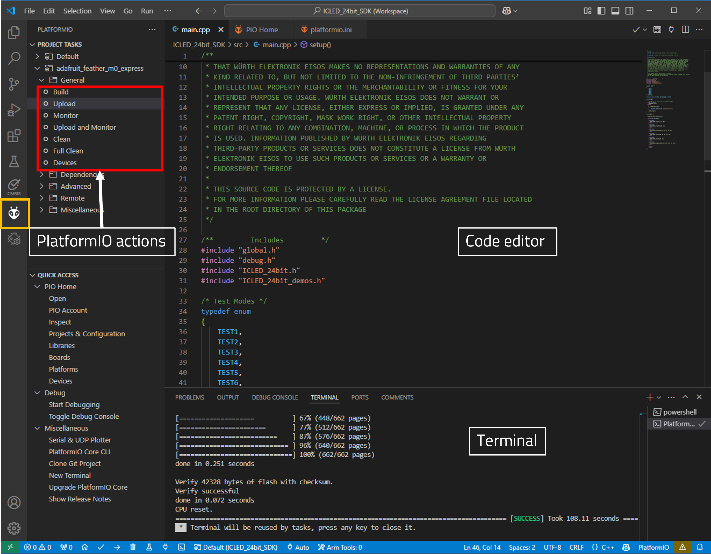

# ICLED

## Introduction

The **ICLED SDK** was designed with rapid prototyping in mind. Being fully compatible with the Adafruit ecosystem, this library allows the Feather M0 and ICLED to be easily integrated into any project.

Here are the salient features of the WE ICLED SDK. 
* The SDK is **open-source** and well documented.
* It uses popular open-source tool chain including an IDE.
* The examples are written in Arduino styled C/C++ for easy understanding.
* The core components of the SDK are written in pure C to enable easy porting to any microcontroller platform.
* Modular structure of the software stack makes it easy to integrate into any project.

### Software components

* **Install IDE**: Use your favourite development IDE (we recommend [Visual Studio Code](https://code.visualstudio.com/) with [PlatformIO](https://platformio.org/) extension).
* **PlatformIO**: This is a cross-platform, cross-architecture, multiple framework professional tool for embedded software development. It provides the tool chain necessary for software development including building, debugging, code-upload and many more. PlatformIO works well on all modern operating systems and supports a host of development boards including the Feathers from Adafruit. Further details about PlatformIO can be found under [platformio.org](https://platformio.org/).
* **ICLED SDK**: The SDK currently implements several quick start examples for the Dual Wire 24-bit ICLEDs.

### Installing the tools

* Install Visual Studio Code on the platform of your choice following the [instructions](https://code.visualstudio.com/docs).
* Follow the instructions under [platformio.org](https://platformio.org/install/ide?install=vscode) to install the IDE extension.

### Quick start example

The quick start example for the ICLED_24bit_SDK demonstrates how to configure the ICLED to display different animations.

1. In the quick start application, the ICLED is configured to show different test based examples. Changing the TEST Mode and re-uploading the code will change the animation on the ICLED board.
   
2. Inside **lib\config.h** the following parameters need to be set-up before building the code.

```C
#define PIN_TOOGLING  true                  // When false, SPI is used for communication, when true, pin toggling (low speed communication) is used

#define ICLED_PN  1315050930246             // ICLED part number used in the demo

#define ICLED_NUM 7                         // Define the size of the ICLED array that is being used
```

3. After defining the communication protocol:
* If <ins>PIN_TOOGLING</ins> is set to true, the default, **DIN** and **CIN** are assigned to **pins 6 and 9**, respectively, but any I/O pin combination on the M0 can be selected for controlling the ICLEDs.

* If <ins>PIN_TOOGLING</ins> is set to **false**, the default SPI communication pins **COPI (MOSI)** and **SCK** on the M0 microcontroller are used for **DIN** and **CIN**, respectively.
  
4. Inside the **main.cpp** file: Define the test mode to be shown. 

```C
static volatile TestMode current_mode = TEST5; // To select the quick example to be shown
```

5. After a succesfull initialization, the ICLED strip is cleared to avoid any color mismatch. 

```C
void setup() 
{
  // Using the USB serial port for debug messages
  #ifdef WE_DEBUG
    WE_Debug_Init();
  #endif
  
   if (!ICLED_Init(RGB))
    {
        WE_DEBUG_PRINT("ICLED init failed \r\n");
    }
    ICLED_clear();
}
```

6. In the **main.cpp** file, the available test examples are shown. See example for the ICLED_24bit_SDK:
   
```C
void loop() {

  ICLED_set_color_system(RGB);

  switch (current_mode)
    {
       case TEST1:
         ICLED_demo_Blink(0, 0x8, 500);                        // Send the data to the first LED in the chain with 50% of maximum current for the selected colors (4-bit value) & 500 ms delay time between data packages 
         break;
   
       case TEST2: 
         ICLED_demo_Breathing(0x8, 100);                       // 50% of maximum current for the selected colors (4-bit value) & 100 ms delay time between data packages 
         break; 
   
       case TEST3:
         ICLED_demo_ColorWhipe(0x00, 0x00, 0xFF, 0x8, 100);    // 50% of maximum current for the selected colors (4-bit value) & 100 ms delay time between data packages
         break;
   
       case TEST4: 
         ICLED_demo_Cyclon(0xFF, 0x00, 0xFF, 0x8, 100);        // 50% of maximum current for the selected colors (4-bit value) & 100 ms delay time between data packages
         break; 
   
       case TEST5: 
         ICLED_demo_Rainbow(0x8, 10);                          // 50% of maximum current for the selected colors (4-bit value) & 10 ms delay time between data packages 
         break;
   
       case TEST6: 
         ICLED_demo_TheaterChase(0xFF, 0xFF, 0xFF, 0x8, 100);  // 50% of maximum current for the selected colors (4-bit value) & 100 ms delay time between data packages
         break;
   
       case TEST7: 
         ICLED_demo_FadingSleep(0x8, 500);                     // 50% of maximum current for the selected colors (4-bit value) & 500 ms delay time between data packages
         break; 
   
       default: 
       break;  
  }
}
```
### Running the example

1. Clone or download the code.
2. Open the workspace with the filename `<ICLED_24bit_SDK>.code-workspace` in Visual Studio code.
3. **Build** and **Upload** the code from the PlatformIO tab as shown in the Figure below.
4. After successful upload, click on **Monitor** in the PlatformIO extension tab to view the debug logs in the serial terminal.



